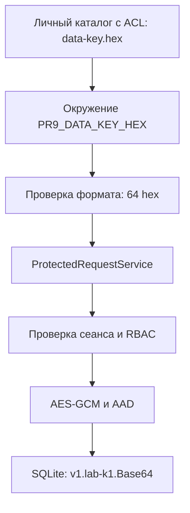

# Практическая работа № 9. Управление секретами

Вариант 17, система мониторинга параметров микроклимата, профиль П1.

## Поле и контекст

`requests.private_note` — конфиденциальная заметка о состоянии оборудования.
В SQLite хранится `v1.lab-k1.<Base64(nonce || ciphertext || tag)>`.
AAD: JSON-массив `["v1.lab-k1", "requests.private_note", "<id>"]`.
ID назначает SQLite до шифрования внутри транзакции создания заявки; при
чтении используется ID из строки БД. Заметка проверяется по NFC и ограничена
2000 байтами UTF-8. Верхняя длина защищенной строки: 2714 символов
(10 + 4 × ceil((2000 + 28) / 3)). Старые записи имеют NULL, их данные не меняются.

| Роль | Создание | Чтение заметки |
|---|---|---|
| user | Своя заявка | Своя заявка |
| operator | Нет | Любая заявка |
| admin | Нет | Нет |
| specialist | Нет | Нет |

Конфиденциальное поле доступно через ProtectedRequestService, который использует
AccessService._operation и реальный AuthService.resolve. Репозиторий v0.6
остается внутренним низкоуровневым компонентом, не интерфейсом клиента.
Новых разрешений нет. Изменение заметок не входит в матрицу v0.8 и не реализовано.
При наличии прав, но неверном теге, возвращается единый ProtectedFieldError.

## Секреты

| Секрет | Назначение | Источник и хранение | Доступ, передача и замена |
|---|---|---|---|
| PR9_DATA_KEY_HEX (lab-k1) | AES-256-GCM | 32 случайных байта, файл data-key.hex вне Git в личном LOCALAPPDATA | Учетная запись запуска, ограниченные ACL; окружение процесса; ротация по схеме ниже |
| lab-tls-key.pem | Закрытый ключ локального X.509 | OpenSSL, P-256; каталог опыта вне Git с ограниченными ACL | Учетная запись стенда; путь передается OpenSSL; при замене выпускается новый сертификат |
| APP_SECRET_KEY | Существующая конфигурация v0.1 | Локальный .env или окружение, значение не публикуется | Учетная запись приложения; load_settings; заменяется отдельно от AES, в v0.9 не используется для шифрования |
| Ключ HMAC опыта | Проверка происхождения байтов в серии A | secrets.token_bytes(32), временно в памяти | Только процесс эксперимента, отдельный от AES; вновь создается при запуске |

Ключ AES не хранится в SQLite, журнале, CSV, Git или снимках экрана. В Git
допустимы имена переменных, идентификатор lab-k1, пустой шаблон и безопасные
синтетические наблюдения. Пароли реальных пользователей не выводятся; v0.7
использует PBKDF2 и хранит хеши токенов и восстановительных кодов. Учебный пароль
демонстрации относится только к изолированным синтетическим учетным записям.

## Схема загрузки и смены ключа

| Этап | Новая запись | Чтение старых | Условие перехода |
|---|---|---|---|
| До ротации | lab-k1 | lab-k1 | Инвентаризация записей и копий |
| Начало ротации | lab-k2 | lab-k1 и lab-k2 по префиксу | Новый ключ в отдельном источнике |
| Перешифрование | lab-k2 | Оба ключа | Расшифровать lab-k1, зашифровать lab-k2 с новым nonce и соответствующим AAD; атомарно заменить строку |
| Завершение | lab-k2 | lab-k2 в активной БД | Ноль записей с lab-k1; контрольные чтения; проверка всех копий |

До истечения срока хранения резервных копий с lab-k1 ключ нужен для
восстановления. После подтвержденного удаления или перешифрования таких копий
и проверки восстановления ключ можно вывести из эксплуатации. Это проектная
схема, автоматическая ротация в v0.9 не реализуется.

## Гипотезы и анализ

H1: A0/A2 — совпадение, A1 — различие, A3 — принято, A4 — отклонено.
A2 не подтверждает происхождение измененной копии; нужен независимый эталон.
HMAC проверяет целостность и происхождение в пределах доверия к владельцам ключа.
H2: B0 — восстановление; B1–B5 — отказ при единственном измененном условии
того же прогона. B0 также регистрирует nonce и длину. Пять различных nonce
подтверждают только конкретный опыт, не гарантируют отсутствие повторов.
H3: C0 — OK, C1 — ошибка имени, C2 — доверия, C3 — срока действия.
Код завершения без диагностики не определяет причину отказа.

П1: для A, Я и … исходные длины 1 символ, соответственно 1, 2 и 3 байта UTF-8.
Расчет защищенных длин: 50, 50, 54. Base64 кодирует блоки по три байта, поэтому
разные длины могут дать одинаковый размер. Фактические результаты фиксируются
скриптом, а не подставляются вручную.

Границы: рассматривается копия хранилища без ключа, локальные сертификаты и
синтетические данные. AES-GCM не заменяет RBAC или TLS; не защищает от захвата
процесса с доступом к ключу, отката ранее корректного значения, удаления,
повторного использования ID после удаления либо утечки метаданных. Для
промышленной эксплуатации нужны управление ключами, надежная уникальность
идентификаторов и nonce, защита резервных копий и контроль версий записей.
