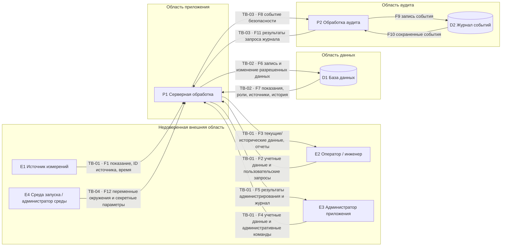

# Модель угроз

## 1. Область анализа

Проект: вариант 17, «Система мониторинга параметров микроклимата».

Анализируются функции F-01 - F-08 из документации v0.2: прием показаний, просмотр текущих и исторических данных, поиск и фильтрация, изменение состояния записи, формирование отчетов, управление учетными записями и ролями, просмотр журнала событий.

### Компоненты, включенные в анализ

В анализ включены текущий модуль конфигурации и запуска, а для проектируемого состояния - серверная обработка пользовательских запросов и показаний, база данных приложения, логический компонент аудита и журнал событий. Также анализируются взаимодействия с источниками измерений, пользователями и средой запуска.

### Внешние зависимости

Для фактической версии v0.2 учитываются среда выполнения Python, переменные окружения и библиотека `python-dotenv`. Для проектируемой системы внешними относительно приложения остаются источники измерений, каналы передачи данных и среда запуска. Конкретная СУБД, веб-фреймворк и протокол обмена с датчиками в v0.2 еще не выбраны, поэтому модель не приписывает им несуществующие свойства защиты.

### Фактическое состояние v0.2

Фактически реализованы:

- минимальное Python-приложение;
- загрузка и проверка параметров `APP_NAME`, `APP_ENV`, `APP_SECRET_KEY`;
- отказ запуска при некорректной конфигурации;
- формирование стартового сообщения без передачи значения секретного ключа;
- `.gitignore` для локальных секретов;
- три автоматических теста стартового сообщения.

Пользовательский интерфейс, сетевой прием показаний, база данных, аутентификация, авторизация, журнал событий и прикладные функции мониторинга в v0.2 не реализованы.

### Проектируемое состояние

Основная модель угроз строится для будущей системы, в которой:

- источники передают показания серверному приложению;
- оператор и инженер используют пользовательский интерфейс;
- администратор использует административные функции;
- прикладные данные хранятся в базе данных;
- события безопасности записываются в отдельное логическое хранилище журнала;
- сервер выполняет аутентификацию, авторизацию, проверку источника и входных данных.

Эти элементы помечаются как проектируемые и не считаются уже реализованной защитой.

## 2. Допущения и ограничения

| ID | Допущение | Статус | Что изменится, если оно неверно |
|---|---|---|---|
| ASM-01 | База данных не публикуется непосредственно в пользовательскую сеть и сеть источников | Требует проверки при реализации | Потребуется отдельный анализ прямых подключений к СУБД и ее аутентификации |
| ASM-02 | Все запросы пользователей и источников считаются недоверенными | Проектное допущение | Исключение допущения создаст необоснованное доверие к клиентским данным |
| ASM-03 | Для каждого источника предусмотрен серверный механизм подтверждения подлинности | Требует проверки; предусмотрено SEC-04 | Без него возрастает вероятность подмены источника и приема ложных показаний |
| ASM-04 | Служебная учетная запись приложения в БД будет иметь минимально необходимые права | Требует проверки | Компрометация приложения может дать более широкий доступ к данным и структуре БД |
| ASM-05 | Журнал событий логически отделен от прикладных данных и запись в него выполняется только серверным компонентом | Требует проверки при реализации | Потребуются дополнительные меры защиты журнала от пользователя и от переполнения общего хранилища |
| ASM-06 | На учебном стенде используются только искусственные данные | Подтверждено документацией v0.2 | При переходе к реальным данным необходимо пересмотреть последствия утечек и требования хранения |
| ASM-07 | Реальные секреты не хранятся в Git, а `.env` исключен из отслеживания | Подтверждено текущим `.gitignore`; требует постоянного контроля | Публикация секрета создаст отдельный сценарий компрометации учетных данных приложения |

## 3. Инвентаризация элементов DFD

| ID | Тип | Элемент | Состояние |
|---|---|---|---|
| E1 | Внешняя сущность | Источник измерений | Проектируется |
| E2 | Внешняя сущность | Оператор или инженер | Проектируется |
| E3 | Внешняя сущность | Администратор приложения | Проектируется |
| E4 | Внешняя сущность | Среда запуска / администратор среды | Частично существует |
| P1 | Процесс | Серверная обработка запросов и показаний | Проектируется |
| P2 | Процесс | Формирование и обработка событий аудита | Проектируется как логический компонент |
| D1 | Хранилище | База данных приложения | Проектируется |
| D2 | Хранилище | Журнал событий безопасности | Проектируется |

## 4. Диаграмма потоков данных

Границы доверия обозначены непосредственно на пересекающих их стрелках диаграммы: TB-01 проходит между пользовательскими/сенсорными клиентами и приложением, TB-02 между приложением и БД, TB-03 между приложением и областью аудита, TB-04 между средой запуска и приложением. Потоки F9 и F10 находятся внутри области аудита и границу доверия не пересекают. На физическом стенде некоторые компоненты могут находиться на одном компьютере, но это не отменяет различий полномочий и служебных учетных записей.

## 5. Потоки данных

| ID | Откуда | Куда | Данные |
|---|---|---|---|
| F1 | E1 | P1 | ID источника, температура, влажность, время, данные подтверждения источника |
| F2 | E2 | P1 | Учетные данные, параметры просмотра, поиска, фильтрации и изменения состояния |
| F3 | P1 | E2 | Текущие и исторические показания, результаты поиска, отчеты |
| F4 | E3 | P1 | Учетные данные, изменение учетных записей и ролей, административные параметры |
| F5 | P1 | E3 | Результаты административных операций и доступные записи журнала |
| F6 | P1 | D1 | Новые показания, разрешенные изменения статусов, учетные записи и роли |
| F7 | D1 | P1 | Показания, сведения об источниках, роли, история изменений |
| F8 | P1 | P2 | Исполнитель, действие, объект, время, результат |
| F9 | P2 | D2 | Нормализованная запись события |
| F10 | D2 | P2 | Запрошенные события журнала |
| F11 | P2 | P1 | Результат чтения журнала |
| F12 | E4 | P1 | APP_NAME, APP_ENV, APP_SECRET_KEY и другие параметры окружения |

## 6. Границы доверия

| ID | Граница | Потоки | Что перестает считаться доверенным | Необходимые проверки |
|---|---|---|---|---|
| TB-01 | Внешние участники и источники -> приложение | F1-F5 | Идентичность отправителя, параметры запроса, идентификаторы объектов и значения показаний | Аутентификация, авторизация, проверка источника, формата, размера, свежести и допустимых операций |
| TB-02 | Приложение -> база данных | F6-F7 | Корректность сформированного сервером запроса и достаточность прав служебной учетной записи | Минимальные права БД, параметризованные операции, проверка инвариантов до записи |
| TB-03 | Приложение -> аудит | F8, F11 | Достоверность источника события, структура события, объем журналирования | Формирование событий сервером, обязательные поля, защита от изменения, квоты и политика хранения |
| TB-04 | Среда запуска -> приложение | F12 | Полнота и допустимость конфигурации, конфиденциальность секретных параметров | Проверка обязательных параметров и режима, отказ при некорректной конфигурации, отсутствие секрета в выводе |

## 7. Точки входа

| ID | Точка входа | Входные данные | Возможный источник | Что проверять | Состояние |
|---|---|---|---|---|---|
| EP-01 | Вход пользователя | Учетные данные | N-01, легитимный пользователь | Подлинность, ограничения попыток, состояние учетной записи | Проектируется |
| EP-02 | Прием показания | ID источника, значения, время, данные подтверждения | E1, N-05 | Подлинность источника, формат, диапазоны, размер, свежесть, повтор | Проектируется |
| EP-03 | Просмотр показаний и истории | Период, фильтры, ID источника | N-02, N-03 | Роль и разрешение операции, корректность параметров | Проектируется |
| EP-04 | Изменение состояния записи | ID записи, новый статус | N-03 | Роль, доступ к записи, допустимость перехода, неизменность самого измерения | Проектируется |
| EP-05 | Управление учетными записями и ролями | Пользователь, новая роль | N-04 | Полномочия администратора, допустимость роли, аудит | Проектируется |
| EP-06 | Просмотр журнала | Период, фильтр событий | N-04 | Административные полномочия, объем выдачи | Проектируется |
| EP-07 | Загрузка конфигурации | Переменные окружения | E4, среда запуска | Наличие обязательных параметров, допустимые режимы, отсутствие вывода секрета | Частично реализовано |

## 8. Покрытие STRIDE

| Категория | Рассмотренные угрозы |
|---|---|
| S - Spoofing | TH-01, TH-02 |
| T - Tampering | TH-03, TH-04, TH-12 |
| R - Repudiation | TH-05, TH-06 |
| I - Information Disclosure | TH-07, TH-08 |
| D - Denial of Service | TH-09, TH-10 |
| E - Elevation of Privilege | TH-11 |

Все шесть категорий применимы к проектируемой системе.

## 9. Реестр сценариев угроз

Каждый сценарий сформулирован как проектная гипотеза: указан нарушитель и его исходный доступ, предполагаемое условие, действие и последствия. Поле «Источник предположения» показывает, из какого элемента v0.2 или проектного решения возник сценарий.

| ID | STRIDE | Элемент | Нарушитель и исходный доступ | Активы | Предполагаемое условие | Действие | Нежелательный результат | Граница | Источник предположения | Состояние |
|---|---|---|---|---|---|---|---|---|---|---|
| TH-01 | S | EP-02, F1, P1 | N-05, доступ к точке приема показаний | AS-01, AS-02 | Сервер доверяет заявленному ID источника или проверка подлинности обходится | Отправляет сообщение от имени зарегистрированного источника | Недостоверное показание сохраняется с ложным происхождением | TB-01 | F-01, AS-01/AS-02, SEC-04 | Проектное предположение |
| TH-02 | S | EP-01, пользовательский сеанс | N-01, получивший идентификатор сеанса инженера или администратора | AS-03, AS-01, AS-07 | После блокировки учетной записи или изменения роли ранее выданный сеанс сохраняет старые полномочия | Повторно использует чужой сеанс после отзыва доступа | Действия продолжают выполняться от имени другого пользователя с уже отозванными полномочиями | TB-01 | Планируемая аутентификация, SEC-01/SEC-02; необходимость актуализации сеанса | Проектное предположение |
| TH-03 | T | EP-04, P1, F6 | N-03, учетная запись инженера | AS-01, AS-07 | Операция изменения состояния принимает также поля самого измерения | Вместе со статусом передает измененную температуру/влажность | Сохраненное показание и история становятся недостоверными | TB-01, TB-02 | F-05, матрица доступа, SEC-05 | Проектное предположение |
| TH-04 | T | EP-04, P1, F6 | N-03, учетная запись инженера | AS-07, AS-01 | Проверяется роль инженера, но не принадлежность/доступ к конкретной записи | Подменяет ID записи и меняет состояние чужой или неназначенной записи | Нарушается целостность состояния и истории записи вне полномочий | TB-01, TB-02 | Ограничение «для доступных записей» в матрице доступа, SEC-02/SEC-03 | Проектное предположение |
| TH-05 | R | EP-05, P1, P2, D2 | N-04, административные функции приложения | AS-03, AS-04 | Изменение роли не фиксирует исполнителя, старую/новую роль или результат | Изменяет роль пользователя | Невозможно достоверно установить автора и содержание административного изменения | TB-01, TB-03 | F-07/F-08, SEC-06 | Проектное предположение |
| TH-06 | R | EP-04, P1, P2, D2 | N-03, учетная запись инженера | AS-04, AS-07 | Изменение состояния не журналируется с исполнителем и объектом | Меняет состояние записи и впоследствии отрицает действие | История действий неполна, расследование затруднено | TB-01, TB-03 | F-05, AS-04/AS-07; отдельного требования аудита состояния в v0.2 нет | Проектное предположение |
| TH-07 | I | EP-03, F2, F3 | N-01 без учетной записи или N-02 с учетной записью оператора | AS-01, AS-02, AS-07 | Сервер не проверяет аутентификацию/полномочия для конкретного запроса просмотра | Запрашивает данные через прямой защищенный маршрут с измененными параметрами | Данные мониторинга или сведения об источниках раскрываются без разрешения | TB-01 | SEC-01, SEC-02, матрица доступа | Проектное предположение |
| TH-08 | I | P1, F3/F5, обработка ошибок | N-01 или пользователь, получающий ответ приложения | AS-05 | Будущий сетевой обработчик ошибки включает значение секретной конфигурации, поступившей из среды запуска | Вызывает ошибочный сценарий и читает диагностический ответ | Раскрывается APP_SECRET_KEY или другой секрет | TB-04, TB-01 | AS-05, SEC-08; текущий стартовый вывод безопасен | Требует проверки при появлении сетевых обработчиков |
| TH-09 | D | EP-02, P1 | N-05, доступ к точке приема показаний | AS-08, AS-01 | Размер и частота сообщений не ограничены подтвержденной мерой | Отправляет поток крупных или частых сообщений | Ресурсы исчерпываются, корректные показания задерживаются или сервис недоступен | TB-01 | F-01, AS-08, SEC-09/SEC-10; лимита входного потока в v0.2 нет | Проектное предположение |
| TH-10 | D | EP-01, P2, D2 | N-01, публичная точка входа | AS-04, AS-08 | Ошибочные попытки входа журналируются, но для журнала нет квоты/политики хранения | Генерирует большое число отклоненных запросов, создающих события безопасности | Журнал заполняет хранилище и может повлиять на доступность сервиса | TB-01, TB-03 | Планируемые вход и журнал, AS-04; точный набор аудируемых событий требует уточнения | Проектное предположение |
| TH-11 | E | EP-04, EP-05, P1 | N-02 или N-03, собственная учетная запись | AS-03, AS-01, AS-07 | Ограничение роли существует только в интерфейсе либо отсутствует на серверном маршруте | Напрямую вызывает операцию более привилегированной роли | Получает инженерную/административную операцию сверх полномочий | TB-01 | Матрица доступа, SEC-02 | Проектное предположение |
| TH-12 | T | EP-02, F1, P1 | N-05, ранее перехваченное или сохраненное допустимое сообщение | AS-01, AS-07 | Нет проверки уникальности и свежести сообщения | Повторно отправляет ранее принятое показание | Старое значение принимается как новое и искажает текущую картину | TB-01 | F-01, SEC-04 не покрывает повтор сам по себе | Проектное предположение |

## 10. Подробные карточки ключевых угроз

### TH-01. Подмена источника измерений

- Категория: S - Spoofing.
- Нарушитель: N-05.
- Активы: AS-01, AS-02.
- Компоненты: EP-02, F1, P1.
- Граница: TB-01.
- Предусловие: нарушитель имеет сетевой доступ к планируемой точке приема показаний.
- Предполагаемый недостаток: сервер принимает заявленный идентификатор без надежного подтверждения либо механизм подтверждения реализован некорректно.
- Сценарий: нарушитель отправляет показание от имени зарегистрированного датчика.
- Последствия: в БД попадают недостоверные значения с ложным происхождением.
- Существующее требование: SEC-04.
- Состояние: проектное предположение. Наличие дефекта в работающем приложении не подтверждено.

### TH-03. Изменение сохраненного показания

- Категория: T - Tampering.
- Нарушитель: N-03.
- Активы: AS-01, AS-07.
- Компоненты: EP-04, P1, F6, D1.
- Границы: TB-01, TB-02.
- Предусловие: инженер имеет разрешение изменить состояние записи.
- Предполагаемый недостаток: сервер принимает в той же операции измененные значения измерения.
- Сценарий: инженер меняет статус записи и одновременно подменяет температуру/влажность.
- Последствия: нарушается целостность фактических показаний и истории.
- Существующее требование: SEC-05.
- Состояние: проектное предположение.

### TH-09. Перегрузка приема показаний

- Категория: D - Denial of Service.
- Нарушитель: N-05.
- Активы: AS-08, AS-01.
- Компоненты: EP-02, P1.
- Граница: TB-01.
- Предусловие: точка приема показаний доступна источнику.
- Предполагаемый недостаток: не установлены или не подтверждены ограничения частоты и размера запросов.
- Сценарий: источник отправляет поток сообщений значительно выше штатной интенсивности.
- Последствия: задержка обработки корректных показаний либо недоступность сервиса.
- Существующие требования: SEC-09, SEC-10; отдельного требования ограничения входной нагрузки в v0.2 нет.
- Состояние: проектное предположение.

## 11. Ограничения модели

Модель не утверждает наличие перечисленных уязвимостей в работающем приложении. Большинство прикладных компонентов еще не реализовано. Сценарии используются для проверки будущих проектных решений. После реализации сетевых интерфейсов, СУБД, механизма аутентификации или изменения схемы развертывания модель должна быть пересмотрена.
