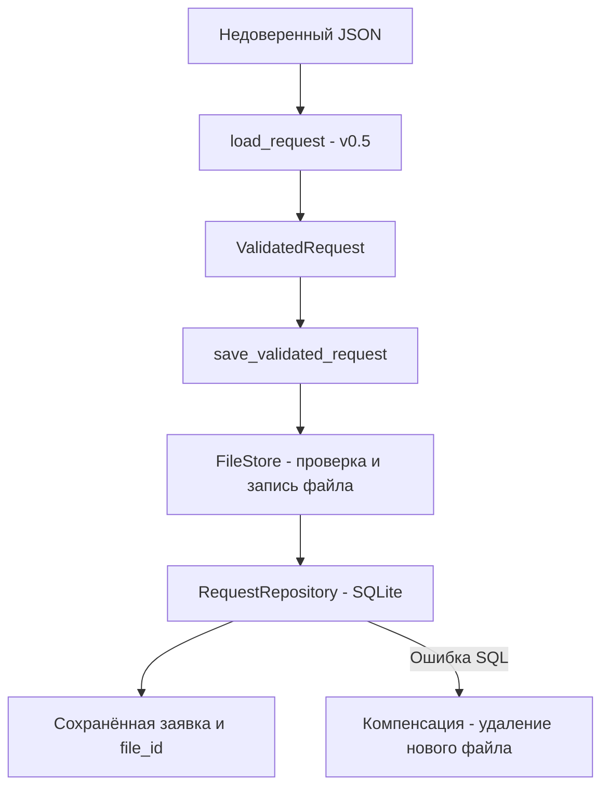

# Практическая работа № 6 - защищённые операции с SQLite и файлами

Проект: вариант 17, «Система мониторинга параметров микроклимата».
Версия: `0.6`. Учебный репозиторий продолжает `v0.5` без замены модулей
измерений, авторизации и аудита. В данной работе сохраняются **JSON-заявки**
из `app/validation.py`, а не реальные показания датчиков.

## Схема взаимодействия

Если вложения нет, сервис записывает заявку непосредственно через
`RequestRepository`. Физический путь определяется только внутренним ID.

## Защищённые SQL-операции

| Операция | Механизм защиты |
| --- | --- |
| `add` | Принимает `ValidatedRequest`, значения через `?`, проверка согласованности вложения и ID |
| `get` | Строго целый положительный ID, параметризованный `SELECT` |
| `list_category` | Категория из allowlist; `ORDER BY` только из фиксированного словаря; ограниченный `LIMIT` |
| `set_priority` | ID и приоритет - целые числа (не `bool`), диапазон 1-5, параметры `?` |
| `delete_unattached` | Не удаляет запись с вложением; блокировка записи на время проверки и удаления |

SQLite дополнительно контролирует `CHECK`, `NOT NULL`, `UNIQUE` и связь
`attachment_key` с `file_id`. Параметризация предотвращает трактовку значений
как SQL-синтаксиса, но не заменяет контроль полномочий, доступный в будущем
прикладном интерфейсе.

## Безопасное файловое хранилище

- Внутренний ID: 32 строчных шестнадцатеричных символа, генерируемых
  `secrets.token_hex(16)`; произвольный пользовательский путь не принимается.
- Категории общего хранилища: `log`, `report`, `screenshot`. Входная
  валидация варианта 17 по-прежнему допускает только `log`.
- Размер: от 1 байта до 1 МиБ включительно.
- `log`: строгая UTF-8-декодировка; по индивидуальному заданию № 17
  дополнительно запрещены BOM в начале и управляющие/форматирующие символы,
  кроме TAB, LF, CR. Это предотвращает неоднозначную интерпретацию журнала,
  скрытые маркеры и подмену визуального порядка текста.
- `report`: начальная сигнатура `%PDF-`; `screenshot`: сигнатура PNG.
  **Сигнатура не гарантирует безопасность содержимого**.
- Запись через `O_CREAT | O_EXCL`, чтение с `fstat`, проверкой обычного
  файла и ограничением размера, `O_NOFOLLOW` при поддержке платформы.

Для индивидуального задания добавлены положительные и отрицательные тесты:
корректная кириллица и переводы строк, обрезанная UTF-8-последовательность,
неверное кодирование суррогата, BOM и форматирующий символ U+202E.

## Системные команды

`safe_argument` запускает фиксированный интерпретатор Python, передавая
пользовательское значение отдельным аргументом: `shell=False`, список
аргументов, ограничение длины 200 символов, тайм-аут 5 секунд.
`shell=True` передаёт строку командной оболочке, которая может интерпретировать
метасимволы. `shell=False` исключает эту интерпретацию оболочкой, но
**не защищает** от опасных опций самой запускаемой программы. Поэтому
допустимые аргументы и вызываемая программа всё равно должны ограничиваться.

## Выявленные проблемы при переходе с v0.5

1. В версии `v0.5` объект `ValidatedRequest` проходил проверку, но
   постоянное SQL-хранилище заявок и физическое сохранение вложений ещё
   не были реализованы. Теперь они добавлены; это не означает, что в
   `v0.5` была SQL-инъекция.
2. Между записью файла и записью SQLite существует окно отказа.
   Добавлено компенсирующее удаление и тест ошибки `sqlite3.IntegrityError`,
   однако аварийное завершение процесса может оставить файл без записи.
3. В методических примерах продемонстрированы небезопасные SQL-конкатенация,
   открытие произвольного пути и `shell=True`. Поиск аналогичных шаблонов
   в существующих модулях не следует считать доказательством их наличия:
   примеры иллюстрируют угрозы, а не обнаруженные дефекты проекта.

## Проверки, проблемы и остаточные риски

| Угроза/ошибка | Защита | Проверка | Остаточный риск |
| --- | --- | --- | --- |
| SQL injection | `?`, фиксированный `ORDER BY` | SQL-подобный заголовок и неизвестная сортировка | Ошибки в будущих запросах вне Repository |
| Некорректный тип/приоритет | Python-проверки и SQLite `CHECK` | `bool`, неизвестная категория, предел `LIMIT` | Нужна авторизация на уровне вызывающего сервиса |
| Path Traversal | Только внутренний `file_id` | `../secret` как ID | Физическая защита каталога зависит от ОС |
| Перезапись | `O_EXCL` | Повторное сохранение и уникальные ID | Требуется защита от недоверенного изменения каталога |
| Большой или некорректный файл | Предел 1 МиБ, сигнатуры/UTF-8 | Размер, неверный PDF, неверный UTF-8 | Нет полного антивирусного/форматного анализа PDF и PNG |
| Command Injection | `shell=False`, список аргументов | Строка `example; echo TEST` | Аргументная инъекция в иной вызываемой программе |
| Ошибка SQLite после сохранения файла | Компенсирующее удаление | Имитированная `sqlite3.IntegrityError` | Нет полной атомарности между SQLite и файловой системой |

На Windows `O_NOFOLLOW` может отсутствовать, а POSIX-права каталога не
полностью выражают модель Windows ACL. Окружение и каталог данных должны
настраиваться с учётом фактической ОС. Тесты не доказывают абсолютную
защищённость, а реальные права доступа и нагрузки требуют отдельной проверки.
