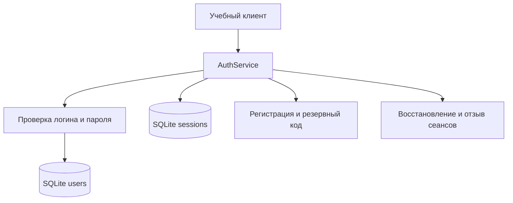
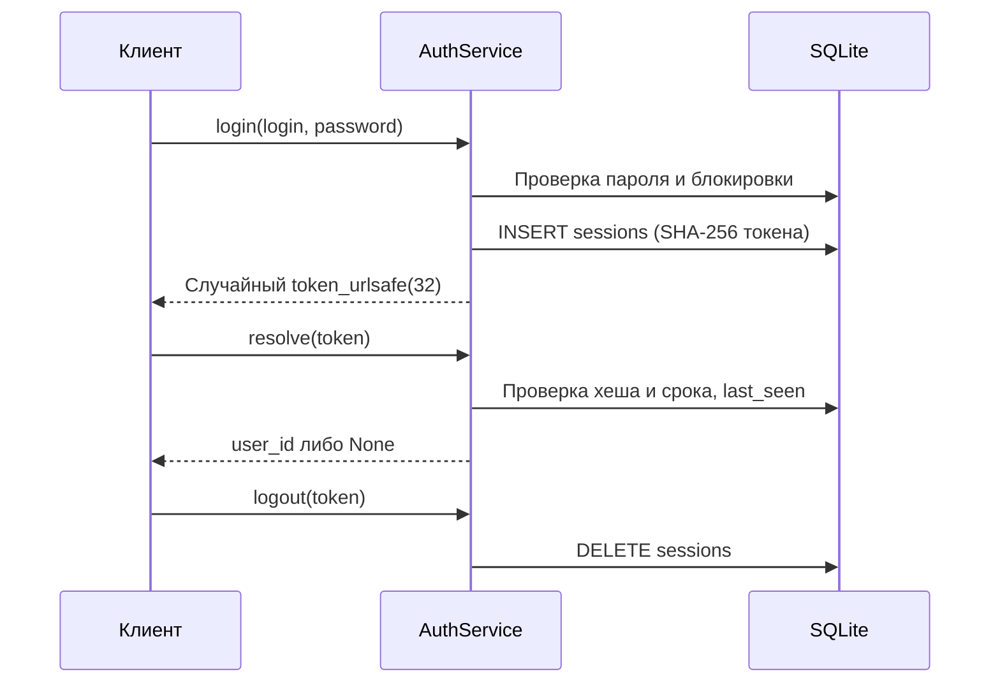

# Практическая работа № 7 — безопасная аутентификация

Версия `v0.7` сквозного проекта «Система мониторинга параметров
микроклимата», вариант 17. Реализован учебный модуль `app/auth.py`; он
использует SQLite и не заменяет ранее созданные модули v0.1–v0.6.

## Архитектура и структура данных

Таблица `users`: `id`, `login UNIQUE`, `salt`, `rounds`, `password_hash`,
`recovery_hash`, `failures`, `blocked_until`, `active`.
Таблица `sessions`: `token_hash PRIMARY KEY`, `user_id` с внешним ключом,
`created`, `last_seen`. Прямой физический файл учебной базы:
`data/users.sqlite3`, который исключён из Git.

## Регистрация и хранение пароля

1. Логин приводится к `casefold()` и должен соответствовать
   `[a-z][a-z0-9_]{2,31}`.
2. Пароль проверяется как строка Unicode, нормализуется в NFC, **не**
   обрезается по краям и **не** переводится в другой регистр. Для нового
   пароля требуется 15–128 символов, 1–1024 байта UTF-8 и отсутствие в
   демонстрационном списке слабых паролей.
3. Для каждой учётной записи выбирается новая соль `secrets.token_bytes(16)`.
   Сохраняется 32-байтовый результат
   `hashlib.pbkdf2_hmac("sha256", password_bytes, salt, 600_000, dklen=32)`.
   Сам пароль в SQLite не сохраняется.
4. Резервный код `secrets.token_urlsafe(32)` возвращается один раз. В базе
   сохраняется SHA-256 кода, не исходное значение. В демонстрации значение
   показывается только в локальном учебном терминале при первой регистрации.

Два пользователя с одинаковым допустимым паролем получают разные соли и
проверочные значения. При неверном пароле возвращается `None`, при неизвестном
логине выполняется дополнительный PBKDF2 с фиктивной солью, что уменьшает
различия обработки. Сравнение выполняется через `hmac.compare_digest()`.

## Ограничение неудачных попыток

- После **пяти последовательных** неудачных попыток для конкретной учётной
  записи выставляется `blocked_until = now + 60`.
- Даже правильный пароль отклоняется во время блокировки. После истечения
  времени вход разрешается. При успешном входе счётчик и блокировка обнуляются.
- `BEGIN IMMEDIATE` сериализует проверку и изменение счётчика в одной SQLite.
  Приложению с высокой нагрузкой потребуется отдельная политика частоты
  запросов и защита от намеренной блокировки чужих учётных записей.

## Управление серверным сеансом

Срок бездействия — **900 секунд (15 минут)**, абсолютный срок — **3600 секунд
(60 минут)**. При превышении любого из них, при отключённом пользователе
или после отзыва `resolve()` возвращает `None`. Время обновляется только в
действительном сеансе; сравнение использует `>=` для точной границы.
Доступ к сессии не означает наличие прикладных полномочий: авторизация —
последующая задача проекта.

## Восстановление доступа

1. Получить существующий логин, действующий одноразовый резервный код и
   новый пароль, соответствующий политике.
2. В SQLite-транзакции `BEGIN IMMEDIATE` сопоставить SHA-256 резервного
   кода с `recovery_hash` через `hmac.compare_digest()`.
3. Выдать новую соль, обновить PBKDF2-проверочное значение и **заменить**
   резервный код новым, ранее не использованным.
4. В той же транзакции удалить все сеансы пользователя.
5. Вернуть только новый резервный код. **Новый сеанс не создаётся**:
   следующий вход требует пароль.

Старый пароль, погашенный код и старые токены становятся недействительными.
Восстановление по электронной почте и уведомление владельца в учебной
версии не реализованы.

## Индивидуальный вариант №17 — Brute Force и Password Spraying

**Дополнительное требование:** сравнить влияние блокировки на два способа
онлайн-подбора: многократные разные пароли для одного логина (Brute Force) и
один/несколько распространённых паролей последовательно для множества логинов
(Password Spraying). Подбор выполняется **только в изолированных тестах** на
временных учётных записях; реальные учётные записи и внешние сервисы не
используются.

| Признак | Brute Force | Password Spraying |
| --- | --- | --- |
| Распределение попыток | Один логин, много паролей | Много логинов, один пароль на круг |
| Срабатывание `MAX_FAILS=5` | Быстро на атакуемом логине | Не срабатывает после одного круга |
| Типичное ограничение | Блокировка конкретной учётной записи | Нужен дополнительный анализ источника/массовых попыток |
| Остаточный риск | Злоупотребление блокировкой | Подбор слабых паролей без порога на отдельной записи |

### Три проверочных сценария

1. `test_16_variant17_brute_force_locks_one_account`: пять разных неверных
   паролей для `student_1` → `blocked_until=now+60`, правильный пароль
   немедленно после блокировки тоже отклонён.
2. `test_17_variant17_password_spraying_avoids_per_account_lock`: один
   одинаковый неверный пароль для шести других пользователей → на каждом
   `failures=1`, `blocked_until=0`, правильный вход возможен. **Доказано
   ограничение** защиты только по учётной записи.
3. `test_18_variant17_repeated_spraying_blocks_after_five_rounds`: пять кругов
   одной неверной попытки для трёх пользователей → все учётные записи
   блокируются; через 61 секунду правильный вход восстановлен.

Вывод: учебная блокировка снижает скорость Brute Force, но после единичного
круга Password Spraying не срабатывает. Для реальной защиты потребуются
ограничения скорости по источнику и сети, анализ массовых неудачных попыток,
мониторинг и меры против распределённой атаки. Эти механизмы **не заявлены
как реализованные** в v0.7, поскольку индивидуальное задание требует
исследования различий, а не изменения политики блокировки.

## Таблица обязательного тестирования

| № | Сценарий | Ожидаемый результат | Тест |
| --- | --- | --- | --- |
| 1 | Правильный пароль | Вход разрешён | test_01 |
| 2 | Неверный пароль | Отказ | test_02 |
| 3 | Повторная регистрация | Ошибка уникальности | test_03 |
| 4 | Одинаковые пароли | Разные соли и хеши | test_04 |
| 5 | Хранение пароля | Открытый пароль отсутствует | test_05 |
| 6 | Короткий новый пароль | Отклонён | test_06 |
| 7 | Дополнительный пробел | Отклонён на входе | test_07 |
| 8 | Неизвестный логин | Отказ | test_08 |
| 9 | Пять неправильных паролей | Блокировка | test_09 |
| 10 | Истечение блокировки | Вход разрешён | test_10 |
| 11 | Выход | Токен отозван | test_11 |
| 12 | Истечение бездействия | Сеанс недействителен | test_12 |
| 13 | Абсолютный срок | Сеанс недействителен | test_13 |
| 14 | Восстановление | Старые сеансы отозваны | test_14 |
| 15 | Неверный резервный код | Восстановление отклонено | test_15 |

Дополнительно: три теста варианта 17, проверка обычной стоимости PBKDF2
`600_000` при регистрации, входе и сбросе, а также подтверждение, что в
SQLite хранятся только хеши токенов и резервного кода. Изолированные
функциональные тесты используют `rounds=1000` ради скорости; эта настройка
не предназначена для обычной эксплуатации.

## Остаточные риски

| Угроза | Реализованная мера | Остаточный риск |
| --- | --- | --- |
| Утечка БД паролей | PBKDF2 и соль | Офлайн-подбор слабого пароля |
| Распространённый пароль | Учебный WEAK | Неполный охват скомпрометированных паролей |
| Brute Force | Блокировка после 5 ошибок | Атаки с разных источников и DoS блокировкой |
| Password Spraying | Счётчик на аккаунт | Медленный распределённый подбор по множеству аккаунтов |
| Перечисление логинов | Один ответ `None` | Различия времени и поведения |
| Угон сеанса | Непредсказуемый токен, серверный отзыв | Кража токена с клиентского устройства |
| Утечка резервного кода | Случайность, хранение SHA-256 | Захват доступа по действующему коду |
| Повторное применение кода | Атомарная замена | Компрометация вновь выданного кода |
| Смена пароля | Отзыв старых сеансов | Не реализованы уведомления и аудит восстановления |
| Отсутствие полномочий | `resolve()` возвращает `user_id` | Ролевая авторизация будет следующей задачей |

Данный модуль — учебный прототип. Требуются дополнительные ограничения по
источнику, контроль прав на SQLite-файл, защита клиентского токена и
полноценные процедуры восстановления и мониторинга в реальной системе.
